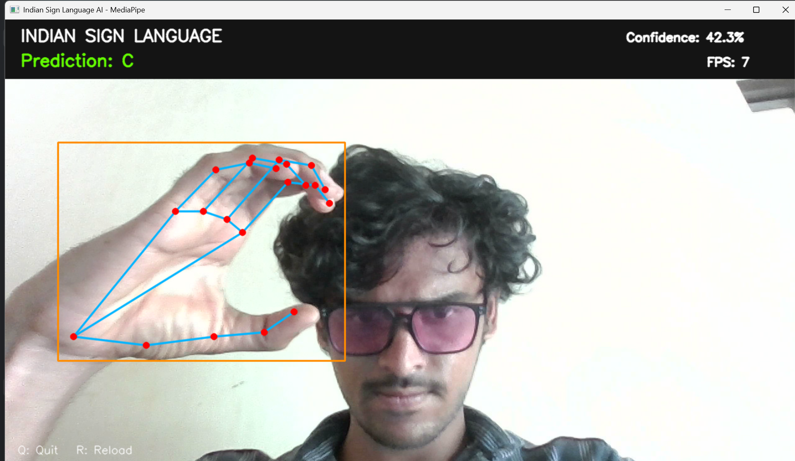

<div align="center">

# Indian Sign Language AI

### Real-Time Hand Sign Recognition Using Computer Vision and Machine Learning


<br>


<br><br>

**Turning hand gestures into recognizable letters through real-time AI.**

</div>

---

## Project Overview

Indian Sign Language AI is a real-time computer vision application that recognizes static Indian Sign Language hand signs through a webcam.

The system detects a hand, extracts 21 hand landmarks using MediaPipe, and passes the resulting numerical features to a trained Random Forest classifier to predict the corresponding letter.

The project combines computer vision, feature extraction, and machine learning in an interactive Python application.

<div align="center">

|   Real-Time Detection  |  AI Classification  |         Live Prediction         |
| :--------------------: | :-----------------: | :-----------------------------: |
| Hand landmark tracking | Random Forest model | Predicted letter and confidence |

</div>

---

## Project Demonstration

<div align="center">

<!-- Replace demo.gif with your actual recorded demonstration. -->


**Live webcam → Hand landmarks → AI prediction**

</div>

> **Note:** Add your actual `demo.gif` file to the repository to display the animated demonstration. Until then, use the `demo.png` screenshot below.



---

## Technology Stack

<div align="center">

| Technology      | Role in the Project                  |
| :-------------- | :----------------------------------- |
| Python          | Application development              |
| OpenCV          | Webcam capture and image processing  |
| MediaPipe Hands | Detection of 21 hand landmarks       |
| Scikit-learn    | Random Forest classification         |
| NumPy           | Numerical feature processing         |
| Joblib          | Saving and loading the trained model |
| JSON            | Storing labels and training reports  |
| PyCharm         | Python development environment       |

</div>

---

## How It Works

<div align="center">

```text
                 LIVE WEBCAM
                      |
                      v
                OPENCV ENGINE
                      |
                      v
              HAND LANDMARK DETECTION
                      |
                      v
                MEDIAPIPE HANDS
                      |
                      v
               21 HAND LANDMARKS
                      |
                      v
                FEATURE EXTRACTION
                      |
                      v
              RANDOM FOREST CLASSIFIER
                      |
                      v
                PREDICTED LETTER
                      |
                      v
                 LIVE DISPLAY
```

</div>

### Recognition Pipeline

**01 — Capture**

OpenCV captures live video frames from the webcam.

**02 — Detect**

MediaPipe Hands identifies the hand and locates 21 important landmarks.

**03 — Extract**

The landmarks are converted into numerical features for classification.

**04 — Predict**

The trained Random Forest model predicts the most likely sign label.

**05 — Display**

The application displays the prediction, confidence score, hand landmarks, bounding box, and FPS.

---

## Features

* Real-time webcam-based sign recognition
* Detection and visualization of 21 hand landmarks
* Random Forest machine learning classifier
* Live letter prediction
* Prediction confidence display
* Frames-per-second monitoring
* Configurable webcam selection
* Optional mirrored webcam view
* Saved model for repeated inference
* Cached landmark features for faster retraining, when supported by the training implementation

---

## Project Structure

```text
SignLanguageAI/
│
├── .venv/
│
├── Indian/
│   ├── A/
│   ├── B/
│   ├── C/
│   ├── ...
│   └── Z/
│
├── model/
│   ├── sign_language_model.joblib
│   ├── labels.json
│   ├── training_report.json
│   └── landmark_cache.npz
│
├── main.py
├── train.py
├── config.py
├── utils.py
├── test_mediapipe.py
│
├── requirements.txt
├── run_app.bat
├── run_train.bat
├── README.md
├── demo.png
└── demo.gif
```

### Important Files

| File                         | Description                                     |
| :--------------------------- | :---------------------------------------------- |
| `main.py`                    | Starts the webcam recognition application       |
| `train.py`                   | Trains the Random Forest classifier             |
| `config.py`                  | Configures webcam and application settings      |
| `utils.py`                   | Contains reusable helper functions              |
| `test_mediapipe.py`          | Tests webcam and hand landmark detection        |
| `requirements.txt`           | Lists project dependencies                      |
| `sign_language_model.joblib` | Stores the trained classifier                   |
| `labels.json`                | Stores the class labels                         |
| `training_report.json`       | Stores training or evaluation information       |
| `landmark_cache.npz`         | Stores cached landmark features, when generated |

---

## Installation Guide

### Step 1 — Open the Project

Open Command Prompt and navigate to the project folder.

```bat
cd "C:\Users\Govardhan Goud\Downloads\SignLanguageAI_PyCharm_MediaPipe\SignLanguageAI"
```

### Step 2 — Activate the Virtual Environment

```bat
.venv\Scripts\activate
```

### Step 3 — Check Python

```bat
python --version
```

### Step 4 — Install Dependencies

```bat
python -m pip install -r requirements.txt
```

### Step 5 — Verify MediaPipe

```bat
python -c "import mediapipe as mp; print(mp.__version__)"
```

Make sure the terminal uses the project's `.venv` environment.

---

## Run the Project

<div align="center">

### Step 01 — Test Hand Detection

</div>

```bat
python test_mediapipe.py
```

Verify that the webcam opens and MediaPipe detects the hand landmarks.

Press `Q` to close the webcam.

<div align="center">

### Step 02 — Train the AI Model

</div>

```bat
python train.py
```

The training script processes the dataset, extracts landmark features, and trains the classifier.

<div align="center">

### Step 03 — Launch Real-Time Recognition

</div>

```bat
python main.py
```

The application starts the webcam and displays its predictions.

### Keyboard Controls

| Key | Action                   |
| :-: | :----------------------- |
| `Q` | Quit the application     |
| `R` | Reload the trained model |

---

## Dataset Organization

The dataset must contain separate folders for each supported letter.

```text
Indian/
├── A/
│   ├── image1.jpg
│   ├── image2.jpg
│   └── ...
├── B/
│   ├── image1.jpg
│   ├── image2.jpg
│   └── ...
├── C/
│   └── ...
└── Z/
    └── ...
```

Each folder should contain correctly labelled images for its corresponding sign.

### Dataset Recommendations

* Include enough images for every class.
* Use different lighting conditions and backgrounds.
* Include variations in hand position and camera distance.
* Remove incorrect labels and unnecessary duplicates.
* Keep training and test images separate to evaluate generalization.

---

## Real-Time Prediction

An example of the application's output is shown below.

<div align="center">

```text
+-----------------------------------+
|       SIGN LANGUAGE AI            |
|                                   |
|       Hand Detected               |
|       Landmarks: 21               |
|                                   |
|       Prediction: A               |
|       Confidence: 94%              |
|       FPS: 30                      |
|                                   |
+-----------------------------------+
```

</div>

*The values are illustrative and do not represent measured project results.*

The confidence score indicates the classifier's estimated support for a prediction. It should not be treated as a guarantee of correctness.

---

## Model Architecture

The project uses a landmark-based machine learning approach rather than directly classifying every image pixel.

```text
                  INPUT IMAGE
                       |
                       v
              MEDIAPIPE HAND MODEL
                       |
                       v
              LANDMARK COORDINATES
                       |
                       v
              FEATURE REPRESENTATION
                       |
                       v
               RANDOM FOREST MODEL
                       |
                       v
                CLASS PREDICTION
```

This design separates hand detection from sign classification, making the workflow easier to inspect and develop.

---

## Configuration

### Webcam Selection

Open `config.py`.

Default camera:

```python
CAMERA_INDEX = 0
```

Alternative camera:

```python
CAMERA_INDEX = 1
```

### Webcam Mirroring

For a mirrored webcam display:

```python
MIRROR_CAMERA = True
```

For normal orientation:

```python
MIRROR_CAMERA = False
```

---

## Current Capabilities and Limitations

| Capability                   | Status             |
| :--------------------------- | :----------------- |
| Webcam capture               | Implemented        |
| Hand landmark detection      | Implemented        |
| Random Forest classification | Implemented        |
| Static sign prediction       | Core functionality |
| Live prediction display      | Implemented        |
| Continuous word recognition  | Future development |
| Sentence-level translation   | Future development |
| Text-to-speech               | Future development |
| Dynamic gesture recognition  | Future development |

The current implementation focuses on static hand poses. It does not yet translate continuous Indian Sign Language into complete sentences.

Indian Sign Language includes movement, grammar, facial expressions, and other contextual information. Recognizing alphabet signs alone is not equivalent to understanding the full language.

---

## Future Development Roadmap

<div align="center">

```text
PHASE 1
Static Letter Recognition
          |
          v
PHASE 2
Dynamic Gesture Recognition
          |
          v
PHASE 3
Word and Phrase Recognition
          |
          v
PHASE 4
Text-to-Speech Integration
          |
          v
PHASE 5
Continuous Sign Recognition
          |
          v
PHASE 6
Web-Based Accessibility Application
```

</div>

### Planned Improvements

**Dynamic Gesture Recognition**

Use temporal models such as LSTMs, GRUs, or Transformers to process sequences of hand movements.

**Word and Phrase Recognition**

Expand the dataset to cover a verified vocabulary of Indian Sign Language words and phrases.

**Speech Output**

Convert recognized text into speech using a text-to-speech engine.

**Improved Prediction Stability**

Use confidence thresholds and temporal smoothing to reduce unstable predictions.

**Multiple-Hand Recognition**

Extend the system to recognize signs requiring both hands.

**Web Interface**

Build a web-based interface for easier demonstrations and access.

**Expanded Dataset**

Improve generalization by using more diverse, correctly labelled data.

---

## Troubleshooting

### Webcam Not Opening

Check the camera index and ensure another application is not preventing webcam access.

### MediaPipe Import Error

Activate `.venv` and install the dependencies listed in `requirements.txt`.

### Incorrect Predictions

Check dataset labels, hand visibility, lighting, and the similarity between training and real-world examples.

### Model File Missing

Run `python train.py` and verify that the expected model files have been generated.

### Low FPS

Measure the time spent on image capture, landmark extraction, and classification to identify performance bottlenecks.

---

## Project Objectives

This project demonstrates practical applications of:

* Computer vision
* Hand landmark detection
* Feature engineering
* Supervised machine learning
* Real-time inference
* Python application development
* Accessibility-focused AI prototyping

---

## Conclusion

Indian Sign Language AI demonstrates how computer vision and machine learning can be combined to recognize static hand signs through a webcam.

By using MediaPipe to extract hand landmarks and Random Forest to classify them, the project provides an interactive foundation for exploring more advanced sign recognition systems.

Future development can extend this foundation toward dynamic gestures, word recognition, speech output, and broader accessibility applications.

<div align="center">

**COMPUTER VISION | MACHINE LEARNING | REAL-TIME AI**

*Building a foundation for more accessible human-computer interaction.*

</div>

---

<div align="center">

### Project Demo


</div>
